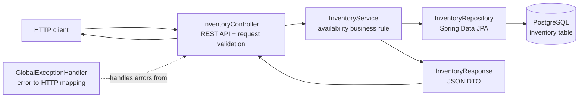
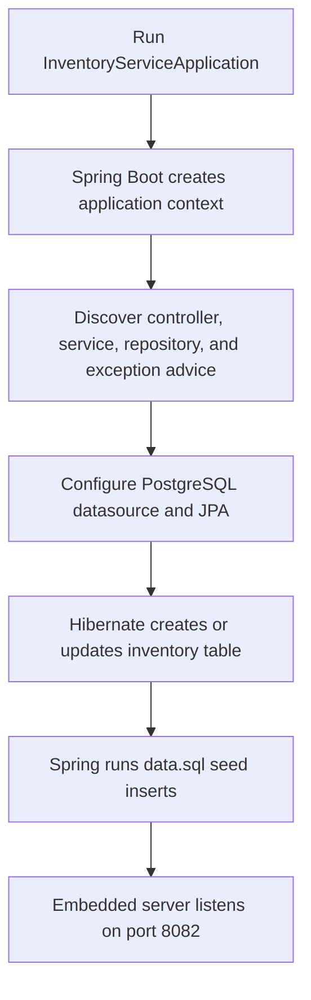
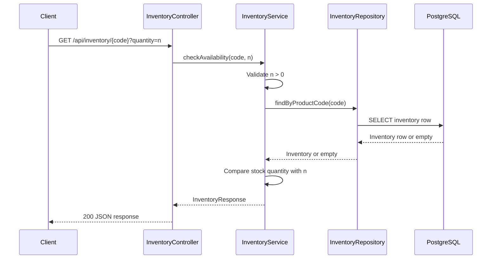

# Inventory Service

Standalone Spring Boot microservice that checks whether a product has enough stock for a requested quantity. The API is read-only: it does not reserve, decrement, or otherwise modify inventory.

## Architecture

The service uses a conventional layered architecture:



| Layer | Implementation | Responsibility |
| --- | --- | --- |
| Bootstrap | `InventoryServiceApplication` | Starts the Spring application context and embedded web server. |
| Web | `InventoryController` | Exposes `GET /api/inventory/{productCode}` and validates `quantity`. |
| Business | `InventoryService` | Validates the quantity, loads inventory, and evaluates `stored quantity >= requested quantity`. |
| Persistence | `InventoryRepository` | Looks up an `Inventory` entity by product code through Spring Data JPA. |
| Data | `Inventory` | Maps the `inventory` table to a JPA entity. |
| Response and errors | `InventoryResponse`, `GlobalExceptionHandler` | Serializes successful results and maps known failures to HTTP responses. |

## Execution flow

### Application startup



At startup, Hibernate uses `spring.jpa.hibernate.ddl-auto=update` to create or update the schema. Because SQL initialization is enabled and deferred until after Hibernate, `src/main/resources/data.sql` inserts the sample products automatically. Each insert uses PostgreSQL `ON CONFLICT DO NOTHING`, so restarts do not duplicate the seed rows.

### Availability request



If the quantity is invalid, the request is rejected with a client error. If the product does not exist, `ProductNotFoundException` is converted by `GlobalExceptionHandler` into a `404 PRODUCT_NOT_FOUND` response. Insufficient stock is not an error; it returns `200 OK` with `available: false`.

## Run locally

Prerequisites: Java 17, Maven, and PostgreSQL.

1. Create the database if it does not already exist:

   ```sql
   CREATE DATABASE inventorydb;
   ```

2. Ensure PostgreSQL is running and the configured credentials can connect. The current local configuration is:

   - URL: `jdbc:postgresql://localhost:5432/inventorydb`
   - User: `postgres`
   - Password: `root`

   For shared or production environments, override these values with environment/profile-specific configuration rather than committing credentials.

3. Start the service from this directory:

   ```text
   mvn spring-boot:run
   ```

The service listens on `http://localhost:8082`.

## API

### Check product availability

```http
GET http://localhost:8082/api/inventory/{productCode}?quantity={positive integer}
```

Example using a seeded product:

```http
GET http://localhost:8082/api/inventory/P1004?quantity=2
```

Response:

```json
{
  "productCode": "P1004",
  "productName": "Shoes",
  "availableQuantity": 10,
  "available": true
}
```

The seeded products are `P1004` (Shoes, 10), `P1005` (Tshirts, 20), and `P1006` (Electronics, 5). An unknown product returns `404`; a request for more stock than available returns `200` with `available: false`.

## Build and verify

```text
mvn clean verify
```

The project currently has no test source files. The main source is under `src/main/java`, configuration is in `src/main/resources/application.properties`, and seed data is in `src/main/resources/data.sql`.
